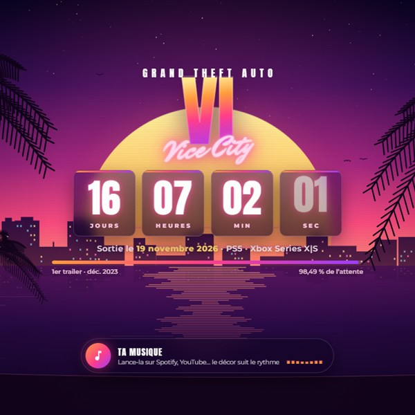

# XDK Fonds d'écran

Les fonds d'écran animés de la **TEAM XDK** pour **Wallpaper Engine**. Ils sont aussi dans
[XDK Hub](https://github.com/XDTEAMDev/XDK-Hub-releases), catégorie **Fonds d'écran**.

## ⭐ GTA VI : Compte à rebours Vice City

Le compte à rebours jusqu'à la sortie de GTA VI, sur un coucher de soleil à Vice City qui bouge au rythme de ta musique.

- **Compte à rebours** en direct jusqu'au 19 novembre 2026 (date modifiable si le jeu est repoussé)
- **Décor animé** : soleil, palmiers, ville éclairée, reflets sur la mer
- **Suit ta musique** : lance Spotify, YouTube ou Deezer, le soleil pulse sur les basses et le lecteur affiche le titre et la pochette
- **Ton propre fichier** : mets ton `musique.mp3` dans le dossier du fond d'écran, avec **vitesse réglable** et **effet slowed**
- **Synthwave intégrée** si tu n'as pas de musique sous la main
- Fonctionne hors ligne, polices incluses

**Installer :**
- **Steam Workshop (recommandé)** : ouvre la [page du Workshop](https://steamcommunity.com/sharedfiles/filedetails/?id=3832447482) et clique sur **S'abonner**. Il apparaît tout seul dans Wallpaper Engine et se met à jour automatiquement.
- **Avec le zip** : télécharge **XDK-Wallpaper-GTA6.zip** dans [sa version](https://github.com/XDTEAMDev/XDK-Wallpapers-releases/releases/tag/gta6-vice-city) et dézippe-le. Dans Wallpaper Engine : **Ouvrir un fond d'écran** (en bas à gauche) → **Ouvrir depuis un fichier**, puis choisis `index.html`.

**Mettre ta musique :** par défaut, le fond d'écran suit le son de ton PC. Pour jouer ton propre fichier, fais un clic droit
sur le fond d'écran dans Wallpaper Engine → **Ouvrir dans l'explorateur**, copie ton fichier audio dans ce dossier sous le nom
`musique.mp3` (ou `.ogg`, `.flac`, `.wav`, `.m4a`), puis mets **Musique** sur **Mon fichier** dans les réglages.

---

Fonds d'écran fan-made, non affiliés aux éditeurs des jeux. Polices Anton, Montserrat et Mr Dafoe sous licence SIL Open Font License.
